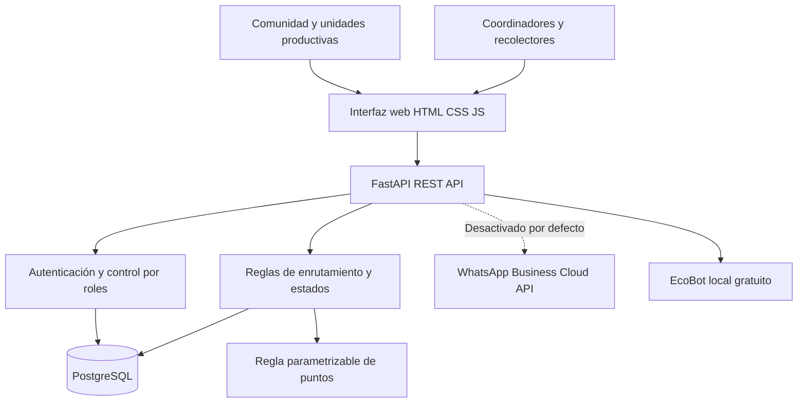

<<<<<<< HEAD
# EcoConecta · Villas de San Pablo

Plataforma web para conectar hogares y unidades productivas con los colectivos de huerteros y recicladores de Villas de San Pablo, Barranquilla.

## Alcance implementado

- Registro e inicio de sesión con contraseña cifrada y token de sesión.
- Perfiles diferenciados: comunidad, coordinación de huerteros, coordinación de recicladores, huertero, reciclador y administración.
- Registro de solicitudes y enrutamiento automático: orgánicos → huerteros; reciclables → recicladores.
- Identificador único, estados e historial de eventos.
- Bandejas filtradas por colectivo y por recolector asignado.
- Asignación y programación con fecha, hora y persona responsable.
- Seguimiento operativo por estados: programada → vehículo en camino → recolección en curso → finalizada.
- Evidencia obligatoria al finalizar: fotografía, peso y tipo de material.
- Notificaciones internas para coordinadores y recolectores por asignación, programación y avance.
- Historial de eventos y consulta de evidencias desde el seguimiento de cada solicitud.
- Cierre de recolección con registro de peso y acreditación de puntos.
- Panel operativo, contenidos de educación ambiental y consulta de puntos.
- PostgreSQL como única base de datos. Despliegue local reproducible con Docker.

## Tecnologías

- Interfaz: HTML5, CSS3 y JavaScript.
- API: Python 3.12 y FastAPI.
- Persistencia: PostgreSQL 16, SQLAlchemy 2 y Psycopg 3.
- Validación: Pydantic.
- Contenedores y versionado: Docker y Git.

## Requisitos

- Docker Desktop con WSL 2 en Windows 11.
- Git.
- Navegador actualizado.

## Ejecución local

1. Clona el repositorio:

   ```bash
   git clone <URL_DEL_REPOSITORIO>
   cd ecoconecta
   ```

2. Abre Docker Desktop y espera a que indique que el motor está iniciado. Luego copia el archivo de variables de entorno:

   En PowerShell:

   ```powershell
   Copy-Item .env.example .env
   ```

3. Configura `SECRET_KEY` y `POSTGRES_PASSWORD` con valores propios y seguros. Si cambias `POSTGRES_PASSWORD`, actualiza también la contraseña dentro de `DATABASE_URL`. El archivo `.env` no se sube a Git. No uses valores de ejemplo en una instalación expuesta a Internet.

4. En la terminal de VS Code, asegúrate de estar dentro de la carpeta `ecoconecta` (la que contiene `docker-compose.yml`). Construye e inicia los servicios:

   ```bash
   docker compose up --build -d
   ```

5. Comprueba que ambos contenedores estén activos con `docker compose ps`. Después abre <http://localhost:8000>. La documentación interactiva de la API está en <http://localhost:8000/docs> y el estado del servicio en <http://localhost:8000/api/health>.

6. Para detener:

   ```bash
   docker compose down
   ```

   Para borrar también los datos locales de prueba (acción irreversible):

   ```bash
   docker compose down -v
   ```

## Cuentas y perfiles internos

El registro público crea exclusivamente cuentas ciudadanas. No se crean administradores, coordinadores ni recolectores de demostración al iniciar la aplicación. Las cuentas internas se crean mediante un procedimiento administrativo seguro; nunca se debe habilitar una selección de rol privilegiado en el formulario público.

## Variables de entorno

| Variable | Propósito |
|---|---|
| `APP_NAME` | Nombre de la aplicación |
| `SECRET_KEY` | Firma de tokens de sesión |
| `DATABASE_URL` | Cadena de conexión PostgreSQL |
| `ACCESS_TOKEN_MINUTES` | Duración del token |
| `POINTS_PER_KG` | Regla configurable de puntos por kilogramo |
| `WHATSAPP_TOKEN` | Token de WhatsApp Business Cloud API (cuando se integre) |
| `WHATSAPP_PHONE_NUMBER_ID` | Identificador del número autorizado |
| `WHATSAPP_ENABLED` | Activa/desactiva explícitamente la integración opcional de WhatsApp (por defecto `false`) |

Nunca publiques valores de secretos, contraseñas o tokens.

## Arquitectura



## Modelo de datos

- `users`: cuentas, perfiles y saldo de puntos.
- `collection_requests`: solicitudes, flujo, dirección, estado, programación, responsable y cierre.
- `request_events`: historial auditable de cambios y acciones.
- `collection_evidence`: fotografía, peso, tipo de material y observaciones de cada cierre.
- `notifications`: bandeja de avisos internos por usuario.

Relaciones: un usuario puede registrar muchas solicitudes; cada solicitud tiene un usuario solicitante, un coordinador y un recolector opcional; cada solicitud puede generar múltiples eventos.

## Reglas de negocio y aceptación

1. `organico` se enruta al colectivo de huerteros; `reciclable` al de recicladores.
2. Solo el coordinador del flujo correspondiente puede asignar y programar.
3. Una solicitud no queda programada sin fecha, hora y recolector válido.
4. El recolector solo puede cerrar una solicitud que le fue asignada y que está programada.
5. Los puntos se acreditan exclusivamente al cerrar la recolección.
6. Los datos de contacto y ubicación no se exponen al usuario solicitante en las listas públicas de solicitudes.
7. El historial conserva los eventos operativos principales.
8. La regla inicial de puntos es un parámetro de demostración. **No es una equivalencia oficial de Fundación Santo Domingo y requiere validación institucional.**

## Recorrido de demostración

1. Inicia sesión con una cuenta ciudadana provisionada por la organización.
2. Crea una solicitud orgánica desde «Solicitar recolección».
3. Ingresa con la cuenta de coordinación de huerteros y programa la solicitud con un recolector activo del mismo flujo.
4. Ingresa con la cuenta del recolector asignado, inicia el recorrido y registra la recolección con fotografía, peso y material.
5. Vuelve a ingresar como ciudadano para consultar el historial, la evidencia y los puntos acreditados.
6. Repite el recorrido con una solicitud reciclable y las cuentas del colectivo de recicladores.

Las credenciales no se publican en este repositorio. El administrador debe provisionar las cuentas internas mediante el procedimiento seguro del proyecto.

## Despliegue en nube

La aplicación está preparada para ejecutarse como contenedor y conectarse a un servicio PostgreSQL administrado. Para la evaluación se debe publicar el contenedor y la base de datos en un proveedor permitido/aceptado por la organización, configurar las variables anteriores, habilitar HTTPS y registrar aquí la URL final y los servicios exactos usados.

- Proveedor de cómputo: **pendiente de selección y despliegue**.
- Servicio de base de datos PostgreSQL: **pendiente de aprovisionamiento**.
- URL pública: **pendiente de despliegue**.
- Almacenamiento y red: **según el proveedor seleccionado; documentar al desplegar**.

No se afirma que exista una URL pública hasta que el despliegue se haya realizado y probado.

## Cierre funcional y controles administrativos

- El administrador dispone de endpoints protegidos para consultar usuarios y actualizar sus roles/estado (`GET/PATCH /api/admin/users`).
- No se permite desactivar al último administrador activo ni que el administrador quite sus propios privilegios durante su sesión.
- Los coordinadores solo operan sobre su flujo; los recolectores solo avanzan y finalizan solicitudes asignadas a su usuario y flujo.
- No se permite asignar/programar solicitudes canceladas o finalizadas ni programar fechas pasadas.
- Los recolectores no pueden cancelar solicitudes.
- La API de salud comprueba la conexión a PostgreSQL y los JSON declaran UTF-8.

## Integraciones y límites conocidos

- WhatsApp Business Cloud API: está preparada como integración opcional, pero permanece desactivada (`WHATSAPP_ENABLED=false`). Las notificaciones internas sí funcionan; el envío externo requiere configuración y revisión de costos/consentimiento.
- EcoBot: asistente local gratuito con base de conocimientos contextual; no requiere OpenAI API ni transmite las preguntas a proveedores externos. No es un modelo generativo y deriva preguntas no cubiertas.
- El sistema no crea cuentas administrativas ni operativas de demostración. Las cuentas internas deben provisionarse mediante un proceso seguro de administración.
- Antes de recibir datos personales reales se debe publicar una política de privacidad y definir responsables y tiempos de conservación.
- Antes de producción: migraciones de esquema, restablecimiento de contraseña, limitación de intentos, política de privacidad, HTTPS, copias de seguridad, auditoría ampliada y pruebas de carga/seguridad.

## Estructura

```text
ecoconecta/
├── app/
│   ├── main.py
│   ├── models.py
│   ├── schemas.py
│   ├── security.py
│   ├── database.py
│   ├── config.py
│   └── static/
│       ├── index.html
│       ├── styles.css
│       └── app.js
├── docs/
│   ├── arquitectura.md
│   ├── modelo_datos.md
│   └── sustentacion.md
├── Dockerfile
├── docker-compose.yml
├── requirements.txt
├── scripts/
│   └── create_staff.py
├── tests/
│   └── test_chatbot.py
└── .env.example
```

## Licencia y uso

Proyecto académico desarrollado para el reto EcoConecta de la Hackathon Universidad Libre – Fundación Santo Domingo. Validar con la organización las condiciones de publicación de marca, logos y datos territoriales antes de una difusión institucional.


## Actualización 1 · seguimiento operativo

La versión incorpora seguimiento por estados (`programada`, `en_camino`, `recolectando`, `recolectada`), evidencia fotográfica obligatoria al cierre (JPG/PNG/WEBP, máximo 8 MB), peso, tipo de material y notificaciones internas para coordinador, recolector y ciudadano. Las imágenes se guardan en el volumen persistente Docker `uploads_data`.


## Endurecimiento adicional · actualización 2.0.1

- Limitación básica de intentos de inicio de sesión por IP y teléfono (8 intentos por ventana de 15 minutos).
- Normalización de teléfono y correo en el registro; detección explícita de teléfono/correo duplicado.
- Límite compatible con bcrypt para contraseñas de hasta 72 bytes UTF-8.
- Solo el perfil comunidad puede crear solicitudes.
- Notificaciones internas también para el ciudadano durante programación, avance y cierre.
- Cabeceras HTTP defensivas (`nosniff`, `DENY`, `Referrer-Policy` y `Permissions-Policy`).
- Escape de contenido dinámico antes de insertarlo en el HTML del navegador.


### Alta de cuentas internas

En una terminal del servidor, después de iniciar los contenedores, ejecuta `docker compose -p ecoconecta exec web python scripts/create_staff.py`. El comando solicita el rol, nombre, teléfono y contraseña de forma interactiva. No habilita roles privilegiados en el registro público. En la base existente conserva los usuarios que ya están creados; no ejecutes altas duplicadas.

### Pruebas locales del asistente

Ejecuta `python -m unittest discover -s tests -v`. Las pruebas cubren preguntas abiertas, preguntas de seguimiento y respuestas de seguridad cuando no hay información confirmada.

### Límites que siguen pendientes antes de producción

El limitador de inicio de sesión vive en memoria del proceso: en despliegues con varios workers/instancias debe sustituirse por Redis o un gateway compartido. No se implementó recuperación de contraseña porque requiere un canal verificado de entrega (correo/SMS) y un secreto de recuperación. Tampoco se incorporó Alembic: no se ejecutaron migraciones ni cambios de esquema en esta entrega. Antes de producción también se requiere HTTPS, respaldo restaurable, política de privacidad, monitoreo, pruebas de carga y revisión externa de seguridad.


## Chatbot y WhatsApp

EcoBot responde preguntas libres mediante una base de conocimientos local, sin API externa ni créditos. Consulta `INTEGRACIONES_CHATBOT_WHATSAPP.md` para conocer su alcance y la activación opcional de WhatsApp. En modo gratuito no se envían mensajes externos automáticamente.


## Ajustes de cierre 2.0.1

Consulta `CIERRE_2.0.1.md` para los cambios de notificaciones, consentimiento de WhatsApp, límites de EcoBot e instalación segura.
=======
# EcoConecta-Villas-San-Pablo
Plataforma digital para la gestión comunitaria de residuos y economía circular en Villas de San Pablo.
>>>>>>> e8870f3106f57df9da338ca7808d1facff821fba
