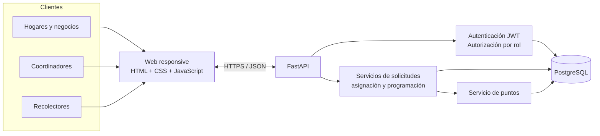
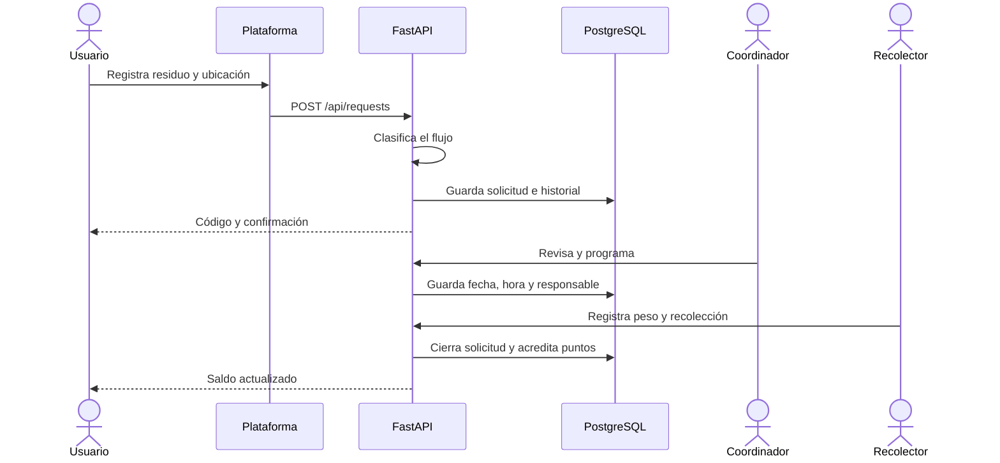

# Arquitectura de EcoConecta

## Vista lógica

## Componentes

- **Interfaz:** aplicación web adaptable a móvil y escritorio. Presenta vistas de comunidad y operación.
- **API:** FastAPI expone endpoints REST, valida entradas con Pydantic y aplica reglas de negocio.
- **Identidad:** contraseñas cifradas y tokens JWT; cada endpoint restringe las acciones por rol.
- **Persistencia:** PostgreSQL almacena usuarios, solicitudes e historial.
- **Puntos:** cálculo determinista y parametrizable ejecutado únicamente al registrar el cierre de la recolección.
- **Contenedor:** Docker empaqueta la aplicación; Docker Compose orquesta API y PostgreSQL en desarrollo.

## Separación de flujos

| Flujo | Colectivo responsable | Perfil coordinador | Perfil recolector |
|---|---|---|---|
| Orgánico | Huerteros | `coordinator_garden` | `collector_garden` |
| Reciclable | Recicladores | `coordinator_recycling` | `collector_recycling` |

## Secuencia de atención

## Seguridad y privacidad

- Los endpoints requieren token, salvo registro, login y health check.
- Las funciones de coordinación se restringen al flujo de su colectivo.
- El recolector solo puede cerrar solicitudes asignadas a su usuario.
- El usuario de comunidad solo consulta sus propias solicitudes e historial.
- El acceso a contacto y dirección se limita a perfiles operativos.
- Secretos se suministran mediante variables de entorno, nunca desde el repositorio.
