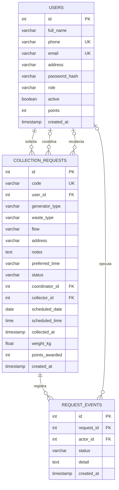

# Modelo de datos PostgreSQL

## Diccionario resumido

| Tabla | Propósito | Reglas |
|---|---|---|
| `users` | Identidad, perfil y puntos | Teléfono único; contraseña almacenada como hash |
| `collection_requests` | Solicitud y ciclo operativo | Código único; flujo orgánico o reciclable; estado trazable |
| `request_events` | Auditoría de eventos | Cada cambio operativo registra actor, estado, detalle y fecha |

## Estados del proceso

`recibida` → `asignada` → `programada` → `recolectada`

También puede terminar en `cancelada`. La API impide cerrar una solicitud no programada. La programación registra simultáneamente fecha, hora y recolector.

## Puntos

`puntos = redondear(peso_kg × POINTS_PER_KG)`

`POINTS_PER_KG` es un parámetro técnico demostrativo. Su valor debe ser validado por Fundación Santo Domingo antes de cualquier operación real.

## Actualización 1: seguimiento, evidencias y notificaciones

- `collection_evidence`: relación con `collection_requests` y `users`; almacena material, peso, ruta de fotografía, observaciones y fecha.
- `notifications`: destinatario, solicitud relacionada, título, mensaje, estado de lectura y fecha.
- `request_events`: registra cada transición de estado, con actor, detalle y marca de tiempo.

Transiciones permitidas para el recolector: `programada` → `en_camino` → `recolectando` → `recolectada`. El cierre exige evidencia fotográfica, peso positivo y tipo de material.
